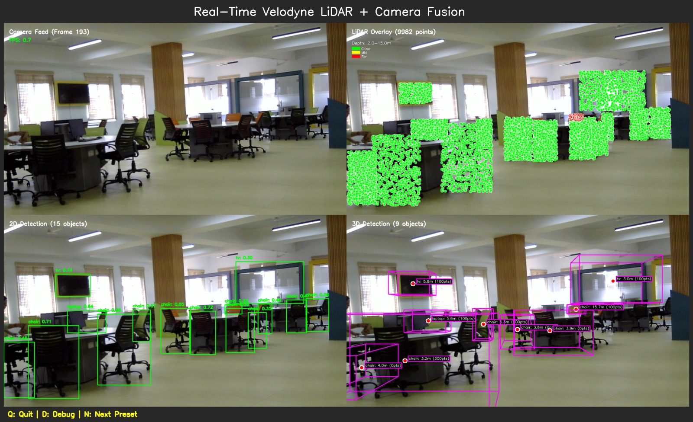
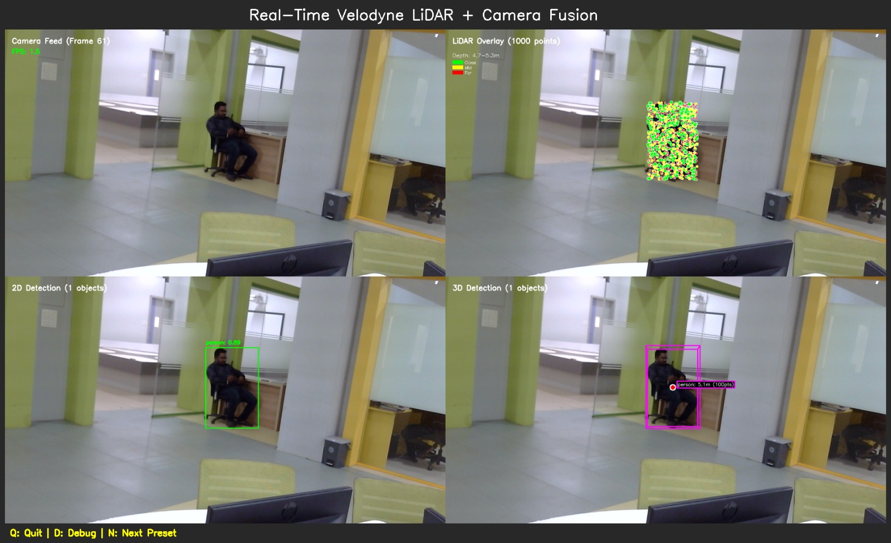

# Multimodal Object Detection Using LiDAR and Camera

A ROS 2 Humble-based project for real-time object detection and camera–LiDAR sensor fusion. The package includes webcam publishing, YOLO-based object detection, Velodyne VLP-16 integration, sensor-fusion nodes, and evaluation utilities.

**GitHub Repository:** https://github.com/chidambardesai/Multimodal-Object-Detection-LiDAR-Camera

## Features

- Real-time camera input using an external webcam.
- YOLO-based object detection using the included `yolov8n.pt` model.
- Velodyne VLP-16 LiDAR integration.
- Camera and LiDAR processing through ROS 2 nodes.
- Sensor synchronization and fusion experiments.
- KITTI subset evaluation with saved metrics.
- Separate webcam and LiDAR-based execution workflows.

## Technologies Used

- Ubuntu 22.04
- ROS 2 Humble
- Python 3
- OpenCV
- YOLOv8
- Velodyne VLP-16
- KITTI 3D Object Detection Benchmark subset

## Repository Structure

```text
kitti_fusion/
├── Images/
│   ├── Picture5.1.jpg
│   └── Picture6.jpg
├── kitti_fusion/
│   ├── calibration_tool.py
│   ├── camera_node.py
│   ├── fusion_node.py
│   ├── kitti_sensor_simulator.py
│   ├── lidar_node.py
│   ├── multimodal_fusion_node.py
│   ├── realtime_detection_node.py
│   ├── realtime_lidar_camera_fusion.py
│   ├── realtime_velodyne_fusion.py
│   ├── synchronized_kitti_node.py
│   └── webcam_publisher.py
├── results/
│   └── fusion_metrics.json
├── scripts/
│   ├── evaluate_fusion.py
│   └── yolov8n.pt
├── resource/
│   └── kitti_fusion
├── test/
├── package.xml
├── setup.py
├── setup.cfg
└── start_velodyne.sh
```

## Requirements

- Ubuntu 22.04 with ROS 2 Humble installed.
- Python 3 and `colcon`.
- External webcam.
- Velodyne VLP-16 LiDAR for live LiDAR processing.
- A compatible Ethernet connection to the LiDAR.
- Required Python and ROS 2 dependencies for the selected node.

Install common system dependencies:

```bash
sudo apt update
sudo apt install python3-colcon-common-extensions \
  python3-opencv ros-humble-cv-bridge \
  ros-humble-velodyne
```

Install any additional Python dependencies required by the specific node you want to run. For example, if the node imports Ultralytics:

```bash
python3 -m pip install ultralytics
```

Use the Python environment compatible with your ROS 2 installation.

## Installation

Clone the repository into your ROS 2 workspace:

```bash
mkdir -p ~/ros2_ws/src
cd ~/ros2_ws/src

git clone https://github.com/chidambardesai/Multimodal-Object-Detection-LiDAR-Camera.git
```

Build the package:

```bash
cd ~/ros2_ws
source /opt/ros/humble/setup.bash
colcon build --packages-select kitti_fusion
```

Source the workspace:

```bash
source ~/ros2_ws/install/setup.bash
```

Run the build and source commands again whenever you make changes that require rebuilding the package.

## Running the Project

### 1. Start the Velodyne LiDAR driver

Open a terminal and run:

```bash
cd ~/ros2_ws/src/Multimodal-Object-Detection-LiDAR-Camera
./start_velodyne.sh
```

**Important network configuration**

The `start_velodyne.sh` script is configured for a particular network setup:

- Ethernet interface: `enp7s0`
- Host IP address: `192.168.1.101/24`
- Expected LiDAR IP address: `192.168.1.201`
- Velodyne data UDP port: `2368`

Check that these values match your actual hardware and network configuration before running the script.

**Warning:** The script flushes existing IP addresses from `enp7s0` before assigning the configured address. Make sure this is the dedicated LiDAR interface and that removing its existing addresses will not disrupt another network connection. The script uses `sudo`, so it may request your password.

If your Ethernet interface has a different name, update `start_velodyne.sh` accordingly. The LiDAR and host must be configured to communicate on the same network.

If the LiDAR is disconnected or is not transmitting data, messages such as `Velodyne poll() timeout` may appear. These indicate that the driver is not receiving the expected data; they do not confirm successful LiDAR operation. The live LiDAR–camera workflow requires a working sensor connection.

### 2. Start the webcam publisher

Open a second terminal:

```bash
source /opt/ros/humble/setup.bash
source ~/ros2_ws/install/setup.bash

ros2 run kitti_fusion webcam_publisher
```

Ensure that the webcam is connected and accessible.

### 3. Start real-time Velodyne and camera processing

Open a third terminal:

```bash
source /opt/ros/humble/setup.bash
source ~/ros2_ws/install/setup.bash

ros2 run kitti_fusion realtime_velodyne
```

This launches the package's real-time Velodyne processing node. Its full operation depends on the camera, LiDAR, network, and topic configuration being correct.

### Running webcam processing without LiDAR

If the LiDAR is disconnected, you can test the webcam publisher separately using step 2. To run a camera-only detection node, use the following command if its dependencies and camera-topic configuration are satisfied:

```bash
source /opt/ros/humble/setup.bash
source ~/ros2_ws/install/setup.bash

ros2 run kitti_fusion realtime_node
```

The camera-only node and the LiDAR-fusion node are separate workflows; running the webcam publisher alone does not establish successful sensor fusion.

## Evaluation Results

The repository includes evaluation results in `results/fusion_metrics.json`, reported for a subset of the KITTI 3D Object Detection Benchmark.

| Metric | LiDAR–Camera Fusion | Monocular Baseline |
|---|---:|---:|
| Frames evaluated | 100 | 100 |
| MAE (m) | 7.33 | 3.43 |
| RMSE (m) | 12.31 | 4.66 |
| Matched objects | 717 | 312 |

**Interpretation:** In this evaluation, the fusion approach produced higher distance-estimation errors than the monocular baseline, while matching more objects. These results do not establish that fusion improves distance accuracy. Further calibration, synchronization, matching, and evaluation are needed.

The metrics apply to the evaluated dataset subset and should not be interpreted as a guarantee of real-time performance or generalization to other environments.

## Screenshots

### Screenshot 1



### Screenshot 2



## Troubleshooting

- **Package not found:** Rebuild the workspace and source `~/ros2_ws/install/setup.bash`.
- **Webcam unavailable:** Check the USB connection and camera permissions.
- **Velodyne timeout:** Check power, Ethernet connectivity, IP addresses, and whether the sensor is transmitting.
- **No detections:** Check the model path, camera topic, confidence threshold, and installed dependencies.
- **No fusion output:** Verify that both sensor streams are active and that topic names, timestamps, calibration, and synchronization settings match.

## Limitations

- Live LiDAR operation requires compatible hardware and network configuration.
- Detection and fusion performance depend on calibration, synchronization, sensor quality, and environmental conditions.
- Evaluation results are based on a limited KITTI subset.
- The supplied network script is configured for a specific Ethernet interface and IP arrangement.

## Author

**Chidambar Desai**

GitHub: https://github.com/chidambardesai

## License

Copyright © 2026 Chidambar Desai. All rights reserved.

This repository is publicly available for viewing. No license has been granted for copying, modifying, distributing, or using this project's code without the author's permission.
